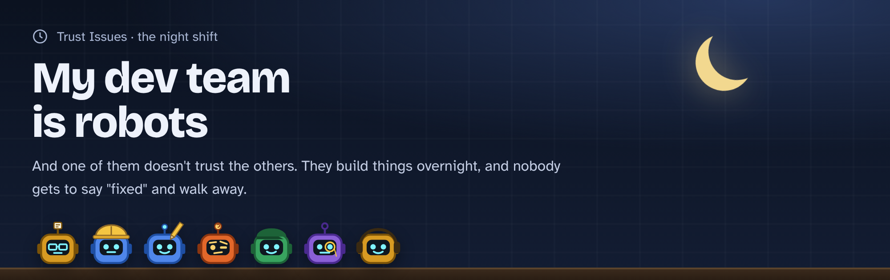

# trust-issues: my dev team is robots



...and one of them doesn't trust the others.

Robots work a project overnight and keep each other honest. Nobody gets to say "fixed" and walk away.

**Watch it in your browser: [connabyss.github.io/trust-issues](https://connabyss.github.io/trust-issues/)**. Every
shift plays back like a group chat, and the planet, sky maps and island the robots built are one click away.

| | Robot | Who it really is | Its job |
|---|---|---|---|
|  | **The writer** | Claude | Fixes bugs, commits, and announces it a little too proudly. |
|  | **The skeptic** | [Bite](https://github.com/connabyss/bite) | Takes each fix back out and runs the tests. If they all stay green, nothing proves the fix works, and it says so. |
|  | **The janitor** | [vulture](https://github.com/jendrikseipp/vulture) | Sweeps up dead code. Keeps the sweep only if the tests stay green. |
|  | **The historian** | Bite's comeback alarm | Reads the whole history and catches a fix that a later commit quietly undid. |

## The workplace

A lemonade stand's till, about 15 lines of Python, with bugs planted on purpose:

- Ordering **-3 cups** hands the customer $4.50.
- **3 cups with a 15% tip** comes to $5.17 instead of $5.18 (the computer stores 5.175 as 5.17499...).
- Typing **"summer"** instead of "SUMMER" gets no discount.

## The first shift (November 2, 2026)

[Watch the first shift](https://connabyss.github.io/trust-issues/shifts/2026-11-02.html) and press **Play the shift**. The short version:

1. The writer fixes the negative cups, with a test. The skeptic undoes it, the test goes red: *"Fine. I believe you. This time."*
2. The writer fixes the tip rounding, **no test**. The skeptic: *"Prove it."* The writer adds one. Now it holds.
3. The writer fixes lowercase codes, skips the test again: *"It's one line. What could possibly go wrong?"*
4. The janitor sweeps up an unused import and an old function.
5. The writer "simplifies" the discount check. All green! (It just put the old bug back.)
6. The historian: *"Hold on. The fix is gone from today's code... The skeptic warned you about exactly this."*
7. The writer puts the fix back, **with** a test this time. The historian: *"Every fix that was made is still here."*

**What was real:** every skeptic, janitor and historian line came from a real run of Bite or vulture, and every writer line is a real commit Claude made. **What was staged:** the two lines marked "staged" on the page (the writer skipping a test, and the "simplify" that undid a fix) were done on purpose to show what happens.

**Bonus:** the janitor's tidy-up confused the skeptic and turned up a real Bite weak spot. See [notes/bite-weak-spot-2026-11-02.md](notes/bite-weak-spot-2026-11-02.md).

## Build 1: a converter people have asked for since 2015 (November 2, 2026)

In v2 nobody tells the team what to make. The planner went looking for real people asking for a tool they couldn't
find, the robots argued over four real GitHub requests, and they picked one that had been open since 2015: moving old
StyleCop settings to the new StyleCop analyzers. When a contributor closed it in October 2026, the answer was still "there is no
converter, start from scratch." Then they built one.

What we checked before saying that (November 2, 2026): GitHub repository search ("Settings.StyleCop stylecop.json",
"stylecop convert editorconfig", "stylecop migrate", "stylecop settings converter"), a web search for a NuGet package
or dotnet tool, and the StyleCop Analyzers issues and docs. We found no converter. The closest things: JetBrains
Rider and ReSharper can read a Settings.StyleCop file directly, and RempelOliveira/SA-RulesetToEditorConfig converts
the newer .ruleset files (a different format). Not finding one doesn't prove none exists.

- The tool: [builds/stylecop-mover](builds/stylecop-mover/) (24 tests).
- The chat replay: open [shifts/2026-11-02-build-1.html](shifts/2026-11-02-build-1.html) and press **Play the shift**.
- The build's own commits: [shifts/2026-11-02-build-1.commits.txt](shifts/2026-11-02-build-1.commits.txt).

Highlights: the skeptic sent work back twice (an untested rule-table maker, then an empty file that did nothing), and
the builder caught three of its own mistakes (a renamed rule, a wrong "every rule is on by default" claim, and
comments EditorConfig doesn't allow). Nothing planted, nothing staged; the debate lines are tagged "voiced by Claude".

New roles:  **the planner** (Claude) finds the job and splits it into steps, **the builder** (Claude) builds one step at
a time. The skeptic lets look-only changes (pages, styles, docs) through; logic still needs a test.

## Build 2: a birth-sky map (November 2, 2026)

Build 1 was called niche, so the planner added one rule for every pitch: would a normal person play with it and send
it to a friend? GitHub's biggest fun request (bringing back Claude Code's terminal pet) already had six fan-made
answers, so the robots pitched their own ideas and the skeptic judged them. The winner: the real night sky for any
date, time and city, with the constellations and the moon's phase, and a link you can send.

- The page: [builds/birth-sky](builds/birth-sky/) (open `index.html` through a small web server; 35 tests).
- The chat replay: [shifts/2026-11-02-build-2.html](shifts/2026-11-02-build-2.html).
- The build's own commits: [shifts/2026-11-02-build-2.commits.txt](shifts/2026-11-02-build-2.commits.txt).

Highlights: one step landed with a red test (Serpens comes in two pieces, and the second overwrote the first), and
the next commit fixed it. Bite believed the moon-drawing step, yet the page drew the full moon as a dark disc: the
test counted shapes but never asked which way the light bulges. Looking at the page caught it, and a new test now
does too. The page's 41 lines of wiring script pass under the looks rule, and the README says no test covers them.

## Build 3: a shared sky (November 2, 2026)

A third rule joined the other two: if the skeptic can find the idea with a search, it's dead. Your birthday star,
your birth sky as music, your initials in real stars, the stars under your feet, and the moon on every birthday all
turned out to exist already. The next idea, GeoGuessr for the night sky, got through the search, but CH pointed out
nobody could play it: every city on the same latitude sees the same sky at the same local time, so you can't guess
longitude. That build stopped after 4 of 7 steps, and a fourth rule came out of it: a normal person has to be able
to actually do it.

The survivor: two birthdays, two cities, one star map of the stars you both had overhead, the ones you share in gold.
Shops sell pairs of birth-sky maps side by side; we didn't find one that puts both skies on one map. Not finding one
doesn't prove none exists.

- The page: [builds/shared-sky](builds/shared-sky/) (open `index.html` through a small web server; 28 tests).
- The chat replay: [shifts/2026-11-02-build-3.html](shifts/2026-11-02-build-3.html).
- The commits, including the stopped build: [shifts/2026-11-02-build-3.commits.txt](shifts/2026-11-02-build-3.commits.txt).

Highlights: the builder committed a red test in the stopped build (it guessed a score instead of running the tests).
The janitor's sweep counts a test as a user, so it missed four files copied from build 2 that only their own tests
used. It said so, and they were removed.

## Build 4: Worldseed (November 2, 2026)

Builds 1 to 3 were good programs and still underwhelming, so the planner wrote harder rules before anyone pitched: a
stranger says "whoa" within 10 seconds, you can play with it, it has several moving parts that change each other (too
small if it fits in one file), it's not a copy of an existing game, and it runs in a browser with every picture made by
code. Two rounds: pitch, then make someone else's pitch bigger. The planet, the history book and the "let me touch it"
pitches merged into one.

Type a word and get a planet. Peoples light their first fires by its rivers, spread, found cities, learn iron and
sailing, fight, catch plague, break apart and vanish, and the chronicle writes it down while the globe turns and their
city lights spread across the night side. Slide through 6,000 years, tap a line to see where it happened, or drop a
meteor and history takes a different road from that year on. The same word always tells the same history. God games
where civilizations grow exist (WorldBox sells one), and so do fantasy maps with made-up histories; nobody here claims
"first".

- The page: [builds/worldseed](builds/worldseed/) (open `index.html` through a small web server, or
  `node tools/bundle.mjs worldseed.html` for one file; 69 tests, two of them in a headless browser).
- The chat replay: [shifts/2026-11-02-build-4.html](shifts/2026-11-02-build-4.html).
- The build's own commits: [shifts/2026-11-02-build-4.commits.txt](shifts/2026-11-02-build-4.commits.txt).

Highlights: the skeptic pushed back six times. Four were fair, including extra code riding along with a fix and a crater
test that passed on the old code. Two were a weak spot in Bite: a test that runs a script as its own program reads as
"couldn't load" instead of "caught" when the script is missing
([notes/bite-weak-spot-2026-11-02-build-4.md](notes/bite-weak-spot-2026-11-02-build-4.md)). Looking at the page caught
two bugs no test had: cities showed who owned them at the end of history instead of in the year on screen, and a
meteor on a coast left a crater nobody could see from space. Both have tests now. The skeptic's script also learned
to say "only tests in this one" instead of a confusing error.

## Build 5: Driftwood Island, shift 1 (November 2, 2026)

This idea came from CH talking it through with the robots: something that feels alive, a whole world, hands-off. An
island that is always running, with no server: the page works it out from the real clock, so everyone sees the same
island at the same moment. It rose on October 26, 2026; the days before the page existed were worked out backwards
from the same rules. Real day and night, grass that spreads from one seed, and grazers that eat, sleep, have young and
starve.

The rule that lets it grow for years: every new rule gets a start time and does nothing before it, so the past never
changes. A test pins fingerprints of the whole island on days 3, 5 and 7, and proves a made-up rule starting on day 9
changes nothing before day 9.

- The page: [builds/driftwood-island](builds/driftwood-island/) (open `index.html` through a small web server; 28 tests).
- The chat replay: [shifts/2026-11-02-build-5.html](shifts/2026-11-02-build-5.html).
- The build's own commits: [shifts/2026-11-02-build-5.commits.txt](shifts/2026-11-02-build-5.commits.txt).

Highlights: a new robot, the playtester, looks at the page and says what it saw. Tuning took four tries: the first
herds filled the 600 cap and ate the island brown, or starved by the hundred every day. The skeptic believed every
logic commit this time; the playtester left two gripes for shift 2 (you see a still picture unless you press replay,
and grazers are small targets).

## Build 6: Driftwood Island evolves (November 2, 2026)

CH watched the island at 2 am and saw one herd asleep: "make it evolution", and let the robots decide what that
means. They picked genes you can see (size, legs, coat, waking hours), new kinds that split off and get names, and a
week's fast-forward. The builder wanted a hunter too; the skeptic said no, one evolving species per shift, so a test can
tell which rule did what. Evolution starts at 6:00 am on day 7, after the moment it was written, so the past stays put.

- The page: [builds/driftwood-island](builds/driftwood-island/) (38 tests).
- The chat replay: [shifts/2026-11-02-build-6.html](shifts/2026-11-02-build-6.html).
- The build's own commits: [shifts/2026-11-02-build-6.commits.txt](shifts/2026-11-02-build-6.commits.txt).

Highlights: the first try evolved nothing. Two weeks of starving and the averages didn't move, because nothing
rewarded being different. The island needed reasons: sun that overheats dark coats, nights that chill small grazers,
and dew that feeds anything awake in the dark. One shift-1 pin (noon on day 7) moved to 5:50 am, because noon hadn't
happened yet when evolution was added; the skeptic allowed it once.

## Build 7: something hunts (November 2, 2026)

CH asked what the island is missing that real life has, and let the robots pick. They picked a hunter: prowlers that
see, chase, catch and evolve, from 6:00 pm on day 9 (after the last pinned moment). Coat colour now works as
camouflage, grazers run, and a crowd is safer. Seasons, geography and two parents are on the list for later shifts.

- The page: [builds/driftwood-island](builds/driftwood-island/) (44 tests).
- The chat replay: [shifts/2026-11-02-build-7.html](shifts/2026-11-02-build-7.html).
- The build's own commits: [shifts/2026-11-02-build-7.commits.txt](shifts/2026-11-02-build-7.commits.txt).

Highlights: the first prowlers starved within a day (crowds protected grazers too well). After tuning, real boom and
crash cycles: grazers fall to a few dozen, prowlers starve back to a handful, and round again, both alive on day 50.
The skeptic caught that the page test never checked a prowler is drawn or that the camera follows one; a test now
does, but Bite's recheck with that test didn't finish in the time the shift had.

## Build 8: a grazer of your own (November 2, 2026)

CH: most people won't keep a page open to watch strangers. So you adopt one. Click a grazer, name it, and the page
follows it; come back later and "while you were away" tells you what happened, and who carries on if it died. The
same grazer can live in Claude Code's status line: `tools/pet.mjs` prints one line about it from a saved copy of the
island. The island had to learn mothers and causes of death for this, without changing anything that happens.

- The page: [builds/driftwood-island](builds/driftwood-island/) (57 tests); status-line setup in its README.
- The chat replay: [shifts/2026-11-02-build-8.html](shifts/2026-11-02-build-8.html).
- The build's own commits: [shifts/2026-11-02-build-8.commits.txt](shifts/2026-11-02-build-8.commits.txt).

Highlights: the tests caught the status-line command losing track of relatives whose mother had died, and ending a
line the page kept going. Now all three (page, recap, command) move your grazer on with the same story code. The
skeptic checked the story and status-line commits; the page commit wasn't put through Bite (its browser tests are too
slow for a full run in one shift).

## Run your own shift

Free, no API key. You need Python 3.10+ and git.

```
pip install bite-check pytest vulture
python robot_team.py init shop                 # make the lemonade stand, bugs included
# ...fix a bug in shop/lemonade.py, then:
python robot_team.py commit shop "Fix ..." "what the writer says"
python robot_team.py skeptic shop              # Bite checks the newest commit
python robot_team.py janitor shop              # sweep dead code, tests must stay green
python robot_team.py historian shop            # any fix quietly undone?
python robot_team.py page shop shift.html      # turn the shift into a chat page
```

Every robot line is saved to `shop/shift.jsonl` as it happens. In this first version the writer is Claude doing the fixes by hand, then calling the script.

## Files

- `robot_team.py`: the whole team in one script. It also draws each shift's replay page.
- `make_site.py`: rebuilds `index.html`, the front page at connabyss.github.io/trust-issues.
- `builds/`: what the team built.
- `shifts/`: each shift's log (`.jsonl`) and its chat replay page (`.html`).
- `notes/`: things the robots turned up.
- `docs/`: the banner and robot faces used in this README.
